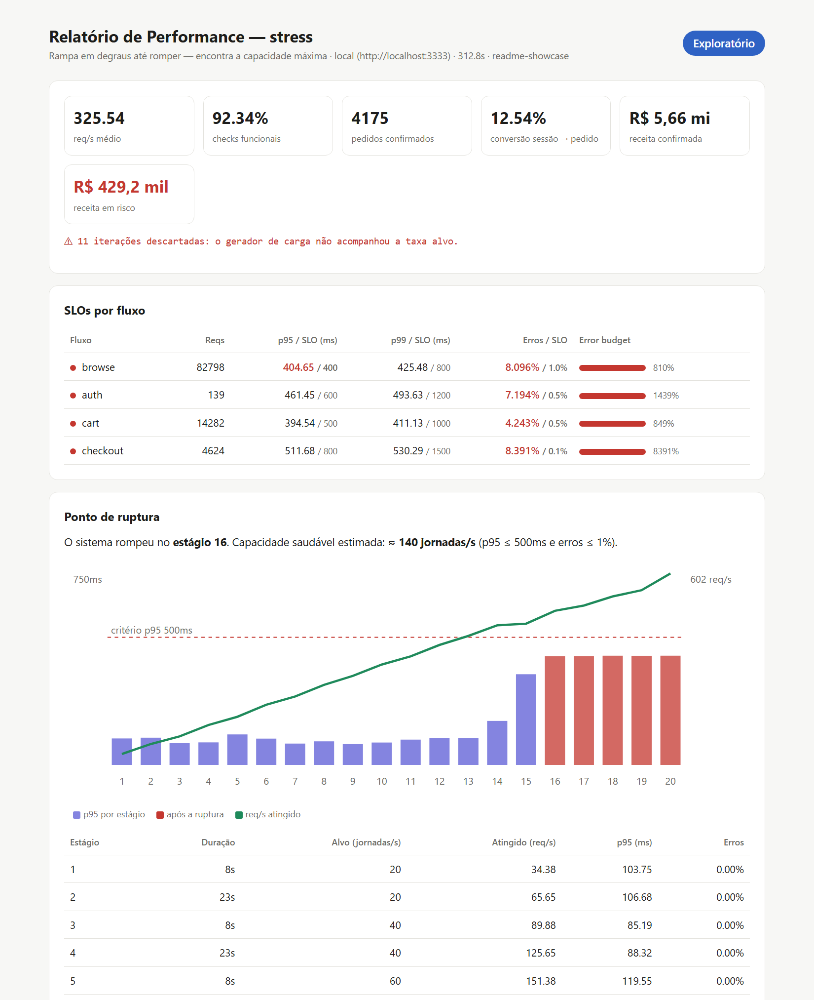

# API Load Testing Suite · k6 + TypeScript

[](https://github.com/FranciscoGorgonho/api-load-testing-suite/actions/workflows/performance.yml)


Suíte de testes de performance para APIs de e-commerce que vai além do "rodar k6 e olhar o p95". Ela **transforma métricas em decisão**: diz se a release passa, onde o sistema quebra e **quanto dinheiro a lentidão custa**.

<p align="center">
  
  <br>
  <sub>Relatório gerado pelo teste de estresse: KPIs de negócio, SLOs com error budget e o <strong>ponto de ruptura detectado automaticamente</strong>.</sub>
</p>

## O que torna esta suíte diferente

| Recurso | O que resolve |
|---|---|
| **SLOs como código** ([`slos.ts`](src/config/slos.ts)) | Uma única fonte gera os thresholds do k6, o *error budget* e o relatório. Mudar um SLA passa por PR. |
| **Detector de ponto de ruptura** ([`stages.ts`](src/lib/stages.ts)) | No teste de estresse, cada resposta é atribuída ao degrau de carga em que ocorreu. O relatório aponta **em qual estágio o sistema rompeu** e qual é a capacidade saudável, sem precisar ler o gráfico manualmente. |
| **Métricas de negócio** ([`metrics.ts`](src/lib/metrics.ts)) | Funil sessão → carrinho → pedido, conversão sob carga e **receita em risco**: o valor dos carrinhos cujo checkout falhou. |
| **Gate em duas camadas** ([ADR 0002](docs/adr/0002-slos-como-codigo.md)) | Thresholds absolutos pegam o que "está ruim". A comparação com a baseline versionada pega o que "ficou pior". |
| **Modelo aberto** ([ADR 0001](docs/adr/0001-modelo-aberto-arrival-rate.md)) | `ramping-arrival-rate` em jornadas/min evita *coordinated omission*, e os perfis viram dados em vez de cópias do script. |
| **API mock com capacidade realista** ([`server.mjs`](mock-api/server.mjs)) | Pool de workers, fila, *load shedding* (503) e injeção de falhas (`CHAOS_*`). O projeto roda inteiro sem depender de ambiente externo, e a ruptura acontece de verdade. |
| **Relatório HTML autocontido** ([`html.ts`](src/report/html.ts)) | Veredito, SLO × realizado, consumo de *error budget*, curva de ruptura em SVG e ranking de endpoints. Funciona offline e fica como artefato do CI. |
| **Observabilidade** ([`infra/`](infra/)) | Prometheus (remote write) e Grafana com dashboard provisionado, filtrado por `testid`. |

## Arquitetura

```
src/
├── config/          # O QUÊ testar e COM QUE critério (dados, não lógica)
│   ├── environments.ts   local / staging + fator de capacidade
│   ├── profiles.ts       smoke · load · spike · stress · soak
│   └── slos.ts           SLOs → thresholds + critério de ruptura
├── lib/             # COMO falar com a API (reutilizável)
│   ├── http.ts           cliente com catálogo de endpoints e tags anti-cardinalidade
│   ├── auth.ts           token por VU com cache e renovação
│   ├── data.ts           massa de teste via SharedArray
│   ├── metrics.ts        funil, receita confirmada/em risco
│   └── stages.ts         atribuição por estágio (knee detection)
├── scenarios/       # Jornadas de usuário
│   ├── browse.ts         vitrine → detalhe → busca (85%)
│   └── checkout.ts       login → carrinho → pedido idempotente (15%)
├── report/          # Métricas → decisão
│   ├── summary.ts        veredito, error budget, ruptura, JSON compacto
│   └── html.ts           relatório visual
└── tests/
    └── ecommerce.test.ts   entrypoint único: ENV + PROFILE
```

## Como rodar

**Pré-requisitos:** [k6 ≥ 1.0](https://grafana.com/docs/k6/latest/set-up/install-k6/) (TypeScript nativo) e Node ≥ 20.

```bash
npm install          # só tipos e TypeScript, para o typecheck
npm run mock         # terminal 1: API mock em http://localhost:3333

npm run test:smoke   # terminal 2: 30 s, sanidade
npm run test:load    # carga normal com SLOs aplicados
npm run test:stress  # degraus até romper, com detecção de ruptura
```

Os perfis podem ser comprimidos sem mudar o formato da curva (útil para demo e CI):

```bash
k6 run -e PROFILE=stress -e TIME_SCALE=0.25 src/tests/ecommerce.test.ts
```

| Variável | Padrão | Uso |
|---|---|---|
| `PROFILE` | `smoke` | `smoke` · `load` · `spike` · `stress` · `soak` |
| `ENV` | `local` | `local` · `staging` |
| `BASE_URL` | do ENV | sobrescreve a URL alvo |
| `TIME_SCALE` | `1` | multiplica a duração de todos os estágios |
| `THINK_TIME_SCALE` | `1` | escala o *think time* (0 desliga) |
| `TEST_ID` | gerado | rótulo `testid` usado no Grafana e no relatório |

### Gate de regressão

```bash
npm run test:load && npm run baseline:update   # promove a execução atual a baseline
npm run test:load && npm run baseline:compare  # exit 1 se p95/p99 > +15% ou erros > +0,5 p.p.
```

Fluxos com menos de 100 requisições ficam **fora do gate relativo** e aparecem como ⚪, porque um p95 de 8 amostras é ruído. Eles continuam protegidos pelos thresholds absolutos de SLO. A regra é coberta por testes unitários (`npm run test:unit`).

| Variável | Padrão | Uso |
|---|---|---|
| `REGRESSION_TOLERANCE` | `0.15` | aumento máximo de p95/p99 |
| `REGRESSION_NOISE_FLOOR_MS` | `15` | variação absoluta ignorada como ruído |
| `REGRESSION_ERROR_DELTA` | `0.005` | aumento máximo da taxa de erro |
| `REGRESSION_MIN_SAMPLES` | `100` | amostra mínima para comparar percentis |

### Provando que o gate funciona (chaos)

```bash
npm run mock:chaos   # 2% de erro e +250 ms de latência injetados
npm run test:load    # → ❌ FAIL, com thresholds violados e receita em risco > 0
```

### Dashboards ao vivo

```bash
npm run infra:up     # Prometheus :9090 + Grafana :3000
K6_PROMETHEUS_RW_SERVER_URL=http://localhost:9090/api/v1/write \
K6_PROMETHEUS_RW_TREND_STATS="p(95),p(99),avg" \
npm run test:load:grafana
```

## CI/CD

[`performance.yml`](.github/workflows/performance.yml):

1. **Typecheck** em todo PR.
2. **Smoke** em todo PR. Se o SLO for violado, o merge fica bloqueado.
3. **Carga + regressão vs baseline** no `main`, todo dia útil (cron) ou sob demanda, com escolha de perfil.
4. O relatório HTML e o JSON ficam salvos como artefatos, e a tabela de regressão aparece no *job summary*.

## Documentação

- [Estratégia de testes de carga](docs/estrategia-testes-de-carga.md): objetivos, SLAs, perfis e arquitetura de métricas.
- [ADR 0001 — Modelo aberto](docs/adr/0001-modelo-aberto-arrival-rate.md)
- [ADR 0002 — SLOs como código](docs/adr/0002-slos-como-codigo.md)
- [Evidência: gates contra API degradada (chaos)](docs/evidence/2026-10-25-chaos/README.md), com logs, relatório e print de uma execução real
